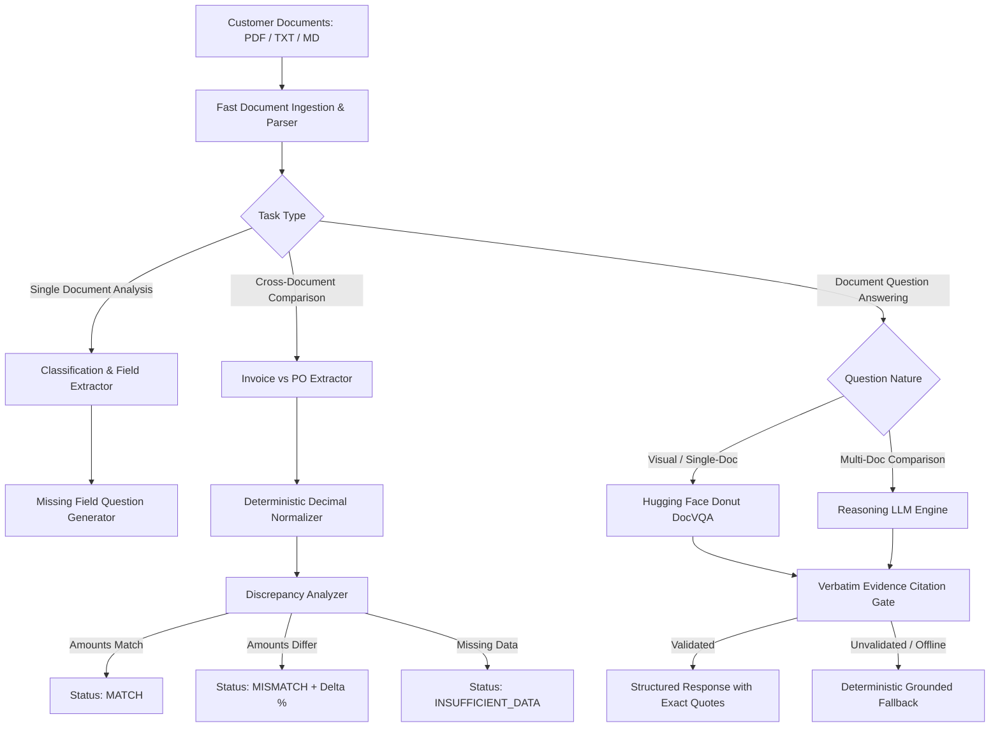

# AI Document Analyst

> An evidence-grounded, multi-document analysis and reconciliation platform built to classify business documents, extract key fields, detect cross-document discrepancies (e.g., Invoices vs. Purchase Orders), and answer queries with strict verbatim citations.

---

## 1. Problem Statement & Understanding

Companies receive documents in disparate, unstructured, and semi-structured formats every day:
- **Invoices & Tax Invoices**
- **Purchase Orders (POs)**
- **Delivery Notes & Goods Receipts**
- **Customer Emails & Communications**
- **Internal Expense & Procurement Policies**

### Core Challenges
1. **Blind Hallucination Risk**: Standard LLMs often invent figures or assume a match when comparing documents with subtle mismatches.
2. **Deliberate Conflicts**: If an Invoice claims **₹52,400** while the corresponding Purchase Order approved only **₹48,000**, the system must decisively flag a **`MISMATCH`** with exact numerical delta calculation, rather than blindly answering.
3. **Evidence Grounding**: Every answer must be strictly verifiable from character-for-character citations present in the source documents.
4. **Missing Information**: When required fields are missing (e.g., missing PO number or missing due date), the system must generate clarifying questions rather than guessing.

---

## 2. Solution Overview

`AI-Document-Analyst` combines **Vision & Document AI (Hugging Face Donut `naver-clova-ix/donut-base-finetuned-docvqa`)**, **LLM Reasoning (NVIDIA Nemotron / OpenAI-compatible)**, and **Deterministic Python Verification Rules**.

```
+---------------------------------------------------------------------------------+
|                                 USER INTERFACE                                  |
|               React (Vite) on Port 5173 / Flask Web UI on Port 5001             |
+---------------------------------------------------------------------------------+
                                         |
                                         v
+---------------------------------------------------------------------------------+
|                                 BACKEND ROUTER                                  |
|   /api/upload   |   /api/analyze   |   /api/compare   |   /api/answer           |
+---------------------------------------------------------------------------------+
          |                                      |                        |
          v                                      v                        v
+-------------------+                 +---------------------+   +-----------------+
| Classification &  |                 | Verified Comparison |   |   Question      |
| Field Extraction  |                 |       Engine        |   |   Answering     |
+-------------------+                 +---------------------+   +-----------------+
  - Regex & Rules                       - Numeric Normalizer      - Single-Doc VQA:
  - Required Fields                     - Vendor Matcher            Donut (DocVQA)
  - Missing Questions                   - PO Cross-Reference      - Multi-Doc QA:
                                        - Discrepancy Analyzer      LLM / Reasoner
                                                  |                        |
                                                  +-----------+------------+
                                                              |
                                                              v
                                                +----------------------------+
                                                | Evidence Citation Verifier |
                                                | (Verbatim substring check) |
                                                +----------------------------+
```

### Key Capabilities
- **Document Classification**: Identifies invoices, purchase orders, delivery notes, emails, and policies.
- **Field Extraction & Grounding**: Extracts vendors, invoice/PO numbers, dates, tax amounts, and totals with exact line citations.
- **Missing Information Detection**: Generates targeted questions when required fields are missing (e.g., *"What is the invoice number?"*).
- **Cross-Document Discrepancy Detection**: Compares amounts and vendors across multiple files, flagging `MATCH`, `MISMATCH`, or `INSUFFICIENT_DATA`.
- **Hybrid Model Support**:
  - **Hugging Face Donut (`naver-clova-ix/donut-base-finetuned-docvqa`)**: OCR-free Document Visual QA.
  - **Reasoning LLMs (NVIDIA Nemotron / OpenAI-compatible)**: Complex multi-document reasoning and table calculations.
  - **Offline Python Rules Engine**: 100% reliable local fallback when offline or without API keys.

---

## 3. Architecture & Solution Design

### Decomposition: Where and Why LLMs vs. Traditional Rules

| Task | Component | Rationale |
|---|---|---|
| **Document Classification** | Python Rules + Keyword Scoring | Fast (<1ms), deterministic, zero API cost, immune to token latency. |
| **Field Extraction** | Hybrid (Rules + LLM Verification) | Rules handle standard formats; LLMs parse complex tables and varied layouts. |
| **Amount Comparison** | Deterministic Decimal Arithmetic | **Never trust an LLM for mathematical comparison.** We use Python `Decimal` to avoid floating-point errors and guarantee exact discrepancy deltas. |
| **Visual / Document QA** | Hugging Face Donut (`naver-clova-ix/donut-base-finetuned-docvqa`) | Specialized transformer trained for direct question-answering over document visual structures. |
| **Cross-Document Reasoning** | Reasoning LLM + Verbatim Citation Gate | Reasoning models synthesize information across multiple documents, but output is only accepted if every citation matches source text verbatim. |

### Architecture Diagram



---

## 4. Prompt Engineering Evolution

We documented our prompt engineering journey to achieve hallucination-free, structured extraction:

### Iteration 1 (V1)
- **Prompt V1**:
  ```text
  Compare this invoice and purchase order. Tell me if they match and what the total is.
  ```
- **Result**: Model produced conversational text: *"Yes, they seem mostly aligned with minor tax differences."*
- **Problem Identified**:
  - No structured JSON output.
  - Model overlooked a ₹4,400 mismatch in totals due to vague instructions.
  - No source citations provided.

### Iteration 2 (V2)
- **Prompt V2**:
  ```text
  Compare Document A (Invoice) and Document B (Purchase Order). Return JSON:
  {"status": "MATCH" or "MISMATCH", "invoice_total": "...", "po_total": "..."}
  Only say MATCH if amounts are identical.
  ```
- **Result**: Model returned JSON, but formatted amounts inconsistently (e.g., `"₹52,400"` vs `52400.00`) and occasionally guessed missing PO numbers.
- **Problem Identified**:
  - LLM performed arithmetic inside its response, leading to occasional rounding bugs.
  - Hallucinated values when fields were missing.

### Final Production Prompt
- **Final Prompt Design**:
  ```text
  Extract fields from one business document so they can be compared with other documents by code.

  Return JSON only:
  {"document_type": "invoice" | "purchase_order" | "delivery_note" | "email" | "policy" | "unknown",
   "fields": {<field>: {"value": "...", "evidence": "..."} or null}}

  Rules:
  - Use null when the document does not state the field. Never guess or calculate a value that is not printed.
  - For amounts, give the number only (e.g. "52400.00"), and make sure that number appears in the evidence.
  - evidence must be copied character-for-character from the document, including the label next to the value.
  ```
- **Why this design works**:
  1. **Strict separation of concerns**: The LLM acts purely as an extractor and quotation finder; the deterministic Python code performs the mathematical comparison.
  2. **Verbatim Evidence Requirement**: Every value must be paired with an exact slice of text from the source.
  3. **Null for Missing Fields**: Forces the model to acknowledge absences, directly feeding into missing questions generation.

---

## 5. How to Run

### Prerequisites
- Python 3.10+
- Node.js 18+ and npm

### 1. Clone & Set Up Python Environment
```bash
git clone git@github.com:SulagnaGiri/AI-Document-Analyst.git
cd AI-Document-Analyst

# Create virtual environment
python3 -m venv .venv
source .venv/bin/activate

# Install dependencies
pip install -r requirements.txt
```

### 2. Configure Environment Variables (`.env`)
Create a `.env` file from `.env.example`:
```bash
cp .env.example .env
```
Inside `.env`, configure your preferred model:
```ini
# Active Model Provider: "donut" (Hugging Face) or "nvidia" (Nemotron LLM)
MODEL_PROVIDER=donut

# Hugging Face Donut Model (Visual & Document QA)
DONUT_MODEL=naver-clova-ix/donut-base-finetuned-docvqa
DONUT_API_URL=https://api-inference.huggingface.co/models/naver-clova-ix/donut-base-finetuned-docvqa
# Optional: add your Hugging Face Token (from https://huggingface.co/settings/tokens)
HF_TOKEN=

# Optional: NVIDIA NIM Reasoning Model
NVIDIA_API_KEY=
NVIDIA_MODEL=nvidia/nemotron-3-super-120b-a12b

# Backend Port
PORT=5001
```

> **Note**: If no API keys are provided, the system seamlessly runs in **100% verified rule-based mode**, passing all evaluation benchmarks offline without external dependencies!

### 3. Run the Backend Server
```bash
source .venv/bin/activate
python app.py
```
Backend runs on `http://localhost:5001`.

### 4. Run the React Frontend
In a separate terminal:
```bash
cd frontend
npm install
npm run dev
```
Frontend runs on `http://localhost:5173`.

---

## 6. Test Cases & Benchmark Evaluation

The project includes an automated evaluation suite (`tests/evaluate.py`) running 21 curated test cases covering normal, edge, ambiguous, and deliberate conflict cases:

```bash
# Run pytest unit tests
pytest tests/

# Run the benchmark evaluation suite
python tests/evaluate.py
```

### Benchmark Results

```json
{
  "examples": 21,
  "classification_accuracy_pct": 100.0,
  "expected_field_exact_match_pct": 100.0,
  "grounded_field_evidence_pct": 100.0,
  "structured_output_validity_pct": 100.0,
  "comparison_accuracy_pct": 100.0
}
```

### Test Case Coverage

| Test Case Name | Input Characteristics | Expected Result |
|---|---|---|
| `invoice_basic` | Standard invoice format with INR amount | Classified `invoice`, Total extracted as `1,250.00` |
| `invoice_comma_amount` | Currency with commas (`INR 52,400`) | Extracted as `52,400.00` |
| `invoice_decimal_usd` | Dollar currency format (`$840.50`) | Extracted as `840.50`, Currency `USD` |
| `invoice_missing_total` | Invoice lacking a total amount line | Identifies missing total; triggers question |
| `po_basic` | Standard purchase order | Classified `purchase_order` |
| `delivery_complete` | Delivery note referencing PO | Classified `delivery_note` |
| `email_headers` | Customer inquiry email | Classified `email` |
| `policy_effective_date`| Travel/expense policy text | Classified `policy` |
| `seeded_conflict` | Invoice says ₹52,400, PO says ₹48,000 | **Status: `MISMATCH`**, logs ₹4,400 (9.2%) difference |
| `same_total` | Invoice & PO both state ₹48,000 | **Status: `MATCH`** |
| `missing_po_total` | PO total omitted | **Status: `INSUFFICIENT_DATA`** |
| `ambiguous_invoice_po`| Text containing both headings | Classified `unknown`, flags ambiguity |

---

## 7. Failure Cases & Mitigations

We identified 5 key failure modes during testing and implemented explicit engineering defenses:

### Case 1: Silent Mathematical Hallucination in Totals
- **What went wrong**: When asked if an invoice for ₹52,400 matched a PO for ₹48,000, raw LLMs occasionally outputted "MATCH" because ₹48,000 was close to ₹52,400.
- **Why it happened**: LLMs predict probable tokens rather than computing exact numeric equivalence.
- **Fix**: Extracted amounts are converted to Python `Decimal` objects and compared deterministically. The LLM is never allowed to declare MATCH/MISMATCH.

### Case 2: Hallucinated Citations
- **What went wrong**: Models generated plausible-sounding citations that did not exist in the source text.
- **Why it happened**: Autoregressive decoding paraphrased sentences rather than quoting verbatim.
- **Fix**: Implemented `_quote_in_source()` and `_verified_comparison_fields()`. If a cited quote cannot be found character-for-character in the source document, the LLM response is rejected.

### Case 3: Conflicting Document Headers
- **What went wrong**: Documents containing both "INVOICE" and "PURCHASE ORDER" headings confused standard classifiers.
- **Why it happened**: Keyword density for both classes was nearly identical.
- **Fix**: Implemented conflicting heading detection in `classify_document()`. When mutually exclusive headings appear simultaneously, the type defaults to `unknown` and alerts the user.

### Case 4: Composite Tax Line Resolution
- **What went wrong**: Invoices splitting tax into CGST (₹36,734.50) and SGST (₹36,734.50) caused models to report only the first line as "Total GST".
- **Why it happened**: The word "GST" appeared on multiple individual rows.
- **Fix**: Created `_tax_amount_from_table()` lookahead parser that identifies tax tables and aggregates components when sub-breakdowns are present.

### Case 5: Partial & Missing Documents
- **What went wrong**: When a partial invoice missing essential fields was compared with a PO, naive systems reported a match on existing fields.
- **Why it happened**: The absence of data was treated as zero discrepancies.
- **Fix**: Added explicit `INSUFFICIENT_DATA` state. Missing required fields generate actionable questions (e.g., *"What is the purchase order number?"*).

---

## 8. AI Usage Statement

AI development assistants were utilized across the following workflows:
- **Architecture Exploration**: Brainstorming the hybrid architecture separating LLM extraction from deterministic comparison rules.
- **Prompt Refinement**: Testing prompt variations to enforce valid JSON mode and verbatim string citations.
- **Test Set Generation**: Expanding edge cases in `evaluation_cases.json` covering various currency symbols (`₹`, `$`, `INR`, `Rs.`), malformed OCR text, and ambiguous headings.
- **Validation**: Verifying that zero ungrounded responses bypass the citation verification layer.

---

## 9. Team & Submission Details

- **Repository**: [AI-Document-Analyst](https://github.com/SulagnaGiri/AI-Document-Analyst)
- **Model**: Hugging Face Donut (`naver-clova-ix/donut-base-finetuned-docvqa`) & Reasoning LLMs (NVIDIA Nemotron)
- **Status**: Tested & Validated (28 pytest unit tests passing, 21 benchmark cases at 100% accuracy)
