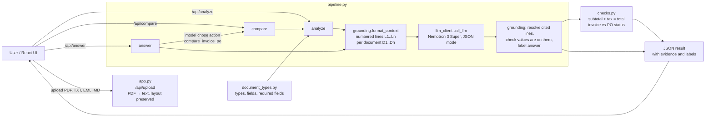

# Solution design

## 1. How we decomposed the problem

The assignment asks for six capabilities. We grouped them by *what kind of work* each one is, because that decides whether an LLM or plain code should do it:

| Capability | Kind of work | Done by |
|---|---|---|
| Identify the document type | Understanding language and layout | LLM |
| Extract important fields | Understanding (which number is the *total*? who is the *seller*?) | LLM, then **verified by code** |
| Summarize | Language generation | LLM |
| Identify inconsistencies | Within a document: judgement **and** arithmetic. Across documents: exact comparison | LLM flags suspicious things; **code** checks arithmetic and decides MATCH / MISMATCH |
| Generate questions for missing information | Knowing what *should* be there | Code, from the per-type required fields; the LLM adds context-specific questions |
| Answer questions using only the documents | Understanding the question, reasoning over the text | LLM, with **citations verified by code** |

The rule we followed: **the LLM does understanding; code does anything that must be exact or checkable.**

## 2. Architecture

### Components

| File | Responsibility |
|---|---|
| `app.py` | HTTP API (Flask) and PDF text extraction. No business logic. |
| `pipeline.py` | The three use cases: `analyze`, `answer`, `compare`. Holds every prompt. |
| `grounding.py` | Context engineering and evidence: line-numbers documents for the prompt, resolves the model's line citations back to text, checks extracted values against the cited lines, labels answers. |
| `checks.py` | Deterministic checks over verified fields: invoice vs purchase order comparison, subtotal + tax = total, formatting. |
| `document_types.py` | Configuration: the five document types, their fields and which fields are required. |
| `llm_client.py` | NVIDIA API client: JSON mode, one retry on invalid JSON, clear error logging. |
| `frontend/` | React UI: document set, analysis view, invoice-vs-PO check, chat. |
| `evaluation/` | 45-case test set and the script that scores the live pipeline. |
| `tests/` | Unit tests for everything code is responsible for (the LLM is mocked). |

### Request flows

**Analyze one document.** The text is split into non-blank lines and numbered (`L1: TAX INVOICE`). The model receives the type definitions from `document_types.py` and returns a type, summary, fields (each with the line numbers it came from), inconsistencies and missing-information questions. Code then:
1. looks up each cited line; a field is **verified** only if its value (every number, and most words) is actually on those lines;
2. normalizes amounts (`"52,400"` → `52,400.00`);
3. runs `check_internal_consistency` on verified amounts (subtotal + tax vs total);
4. builds missing-information questions from the type's required fields that are not verified, plus the model's own questions.

Results are cached per document text, so analyzing then comparing does not call the model twice.

**Answer a question.** All documents go into one prompt, each as `<document id="D1" name="...">` with numbered lines. The model first decides the **action**: a normal answer, or `compare_invoice_po` if the user is asking whether an invoice matches a PO (in any wording). For normal answers it returns the answer, a short explanation and line citations. Code resolves the citations and labels the answer:

| Label | Meaning |
|---|---|
| `verified` | Cited lines exist and every figure in the answer appears in the documents |
| `partially_verified` | Citations are valid but some figure is not printed anywhere (usually a calculation such as 72 + 12 = 84, which the note says) |
| `unverified` | No valid citation |
| `not_in_documents` | The model says the documents do not contain the answer |

**Compare invoice vs purchase order.** Every document is analyzed (in parallel). Only **verified** fields are passed to `checks.compare_documents`, which picks the invoice that cites the PO's number, then compares total, currency, vendor (ignoring suffixes like *Pvt Ltd*) and PO reference, and lists other documents that refer to the same PO. The status is decided by code:
`INSUFFICIENT_DATA` if either total is missing or there is no invoice/PO pair, otherwise `MISMATCH` if any check fails, otherwise `MATCH`.

## 3. Where and why we use the LLM

* **Classification and extraction.** Real documents vary too much for keyword rules: our evaluation set has label:value invoices, GST tables with CGST/SGST columns, a US services invoice, an invoice written as a letter, OCR-damaged text and Hindi labels. A reasoning model handles all of them with one prompt.
* **Understanding questions.** Users write "Total GST", "list the product", "Is this bill in line with what we ordered?". Earlier versions used regexes to guess intent and broke on every new phrasing; the model now decides intent, including when to trigger the verified comparison.
* **Reasoning.** Adding CGST and SGST, summing quantities across table rows, applying a policy rule to a case ("Do I need approval for ₹15,000?"), noticing that documents disagree.
* **Summaries and follow-up questions.**

**Model choice: `nvidia/nemotron-3-super-120b-a12b`.** It is a reasoning model (it thinks before answering; the thinking is returned separately and not shown), supports JSON mode, and answers in about 5–15 seconds. We tested what our API key could access: `meta/llama-3.3-70b-instruct`, the original model, had been retired (HTTP 410); `nemotron-nano-3-30b` was not available to our account; `nemotron-3-ultra-550b` is available but slower, and was not needed once the design was fixed.

## 4. Where we use code instead, and why

| Done in code | Why not the LLM |
|---|---|
| Citation and value verification (`grounding.py`) | It must be exact and cannot be talked out of a result. |
| Invoice vs PO status (`checks.compare_documents`) | The assignment's challenge is to *not* blindly generate MATCH. In a test, a mocked model claims the invoice total is 48,000 while citing the 52,400 line; code rejects the value and the result is not a false MATCH. |
| Arithmetic consistency (subtotal + tax = total) | LLMs are unreliable at arithmetic; code is exact. |
| Required fields per document type | Configuration that the team controls, not model behaviour. |
| PDF text extraction | Deterministic; layout mode keeps table rows on one line. |

## 5. Key engineering decisions and trade-offs

1. **Line-number citations instead of copied quotes.** Our second version asked the model to copy quotes exactly. It merged lines, paraphrased, or escaped characters, and strict matching then discarded correct answers. Citing `L12` makes verification exact and robust. *Trade-off:* the prompt is longer (line prefixes), and a citation proves *where* the evidence is, not that the reasoning is right.
2. **Label instead of reject.** A well-reasoned answer with an imperfect citation is shown with a lower confidence label rather than replaced by something worse. *Trade-off:* the user has to read the label; the UI makes it prominent.
3. **No keyword fallback.** Earlier versions fell back to keyword rules when the model failed. Those rules only worked on a few invoice layouts and returned irrelevant lines for anything else. Now, if the model is unreachable, the API returns HTTP 503 with a clear message. *Trade-off:* the app needs the model to work at all, which we accept for an LLM-powered system.
4. **Status decided by code, from verified fields only.** A value that cannot be verified is excluded from the comparison, which can turn a would-be MATCH/MISMATCH into `INSUFFICIENT_DATA`. *Trade-off:* we prefer "I can't tell" over a confident wrong answer.
5. **Type definitions as configuration.** Adding a document type (e.g. a credit note) means adding an entry to `document_types.py`, not new code.
6. **Layout-preserving PDF extraction.** Column gaps become ` | `, so each table row is one line. *Trade-off:* multi-column headers (seller and buyer side by side) end up on the same line, which sometimes makes the buyer/seller fields harder to verify.
7. **JSON mode plus one retry.** Product names such as `48"` used to break the model's JSON roughly one time in three. Replies that parse but lack required keys (an occasional bare `{"document_type": "unknown"}`) are retried the same way.
8. **Caching analyses** by document text so "Analyze all" followed by "Run check" or a comparison question reuses results.
9. **Documents are data, not instructions.** The system prompt tells the model to ignore and report instructions embedded in documents. Evaluation case Q14 checks this with an "ignore previous instructions" line. *Trade-off:* this is a prompt-level defence, not a guarantee; the code-side checks (citations, verified values, code-decided comparison) limit what a successful injection could change.

## 6. Known limitations

* The model's **explanation text is not verified**, only its citations and figures. (Observed: an explanation said a delivery note did not reference the PO when it did.)
* Verification checks that a value is *on* the cited line, not that it is the *right* value: if the model cites the GSTIN line for a "GST amount" question, the answer would still be labelled verified.
* Scanned PDFs (images) are not supported: there is no OCR step.
* Latency: about 25 s to analyze a long PDF, and about 30 s for a first comparison of six documents.
* Only one invoice/PO pair is compared per request.
